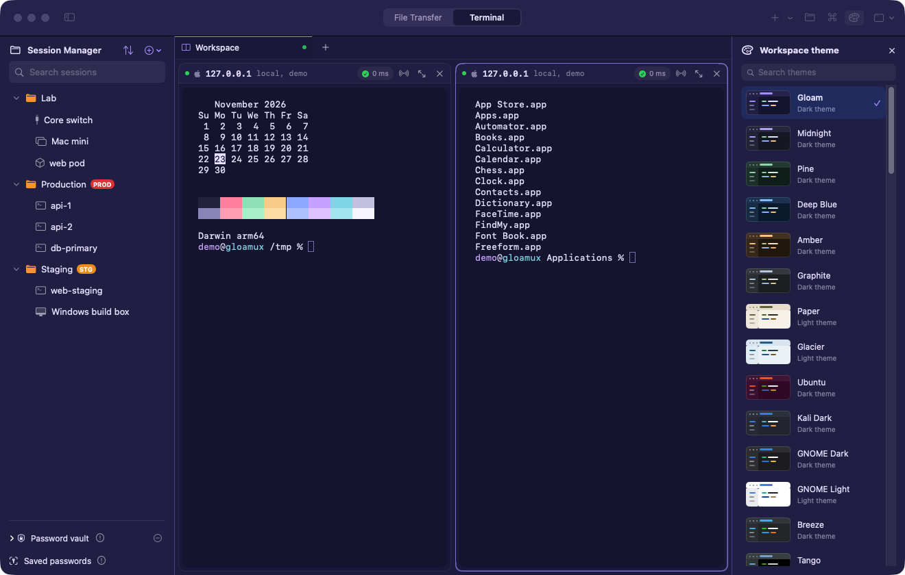
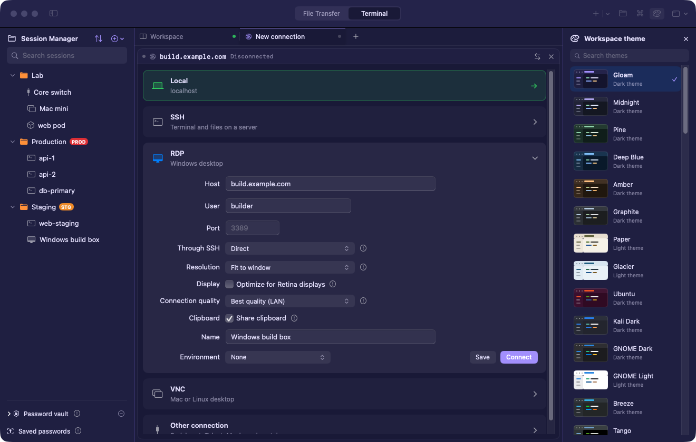

# Gloamux

[English](README.md) · [繁體中文](README.zh-TW.md)

**A native macOS workspace for SSH, file transfer, and remote desktops.**

Current release: **Gloamux 1.3.2 (build 8)**.

Gloamux keeps your servers in one window: saved connections in folders, terminals side by side, the server's files next to the shell, and Windows or Mac desktops in a tab. It is built with Swift, SwiftUI, and AppKit, keeps everything on your Mac, and provides the `gloamux` command line for session management, terminal control, file transfers, and workspace settings. Remote desktop keyboard and pointer input uses the app. Vault setup, unlocking, and secret display also stay in the app.

<p align="center">
  <a href="https://github.com/LuckyFishOno/Gloamux/releases/latest"></a>
  
  
  
  
</p>

<p align="center">
  
</p>

<p align="center">
  <a href="https://github.com/LuckyFishOno/Gloamux/releases/latest/download/Gloamux.dmg"><strong>Download Gloamux</strong></a>
  ·
  <a href="https://gloamux.gloamkit.net">Website</a>
  ·
  <a href="docs/en/USER-GUIDE.md">User guide</a>
  ·
  <a href="#install">Install</a>
  ·
  <a href="#first-launch">First launch</a>
  ·
  <a href="#command-line">Command line</a>
  ·
  <a href="#build-from-source">Build from source</a>
  ·
  <a href="https://github.com/LuckyFishOno/Gloamux/issues">Report an issue</a>
</p>

## Why use it?

Gloamux is for people who look after servers from a Mac and would rather not juggle a terminal, an SFTP client, a remote desktop app, and a text file of hostnames. It takes the workflows of tools such as Xshell and MobaXterm and rebuilds them as a native Mac app.

| What you get | Why it matters |
| --- | --- |
| **One workspace for every connection** | SSH, SFTP, FTP/FTPS, RDP, VNC, serial, Telnet, Mosh, containers, and pods live in one folder tree. |
| **Terminals that fit the work** | Tabs, drag-to-split panes, typing into every pane at once, and 73 color themes. |
| **Files next to the shell** | A Finder-style file sidebar that follows the focused pane, plus a two-pane transfer view. |
| **Sign in once** | Passwords stay on this Mac behind the Secure Enclave, with an optional master-password vault. |
| **Guard rails for production** | Tag environments, and confirm risky commands before they run on a production server. |
| **Scriptable** | The `gloamux` command line provides session, terminal, and file operations. The local MCP server gives AI agents access to approved sessions. |
| **Private by default** | No account or telemetry. Saved-host reachability probes and update checks can each be turned off in Settings. |

## See it

<p align="center">
  
</p>

New connection lists Local, SSH, RDP, VNC, and Other connection. A remote desktop can go through an SSH tunnel and pick its resolution, Retina rendering, and connection quality.

## Features

- **Terminal** · Tabs, drag-to-split panes, local shell, shell integration (prompt marks, command status, notifications), find, logs, recordings with secrets masked, and 73 themes.
- **SSH** · Passwords, Ed25519, ECDSA, and RSA keys, `ssh-agent`, Secure Enclave keys, keyboard-interactive sign-in, up to eight jump hosts listed in order with a route that shows each hop, SOCKS and HTTP proxies, port forwarding, agent forwarding, and X11 through XQuartz.
- **Files** · A file sidebar that follows the focused pane, a two-pane transfer view with a resumable queue, Quick Look, and editing remote files in Mac apps, over SFTP, SCP, FTP, and FTPS.
- **Remote desktop** · RDP with Network Level Authentication and VNC, including macOS Screen Sharing, in a Gloamux tab, with an optional SSH tunnel and a shared clipboard.
- **Other connections** · Serial ports, Telnet, Mosh, Docker containers, Kubernetes pods, and AWS Systems Manager sessions.
- **Safety** · Production, Staging, Test, and Development tags, confirmation of risky commands, host key review and history, and a workspace lock.
- **Bring your sessions** · Import from Xshell, MobaXterm, PuTTY or KiTTY, OpenSSH, and CSV, and export without passwords. Find hosts with Bonjour, Tailscale, and AWS.
- **Automation** · Quick commands, output triggers, Markdown runbooks, the command palette, Spotlight, Shortcuts, and `gloamux://` links.
- **Make it yours** · Default, Classic, and Workbench layouts, an adjustable app text size, and an interface in English, Traditional Chinese, Simplified Chinese, Japanese, and Spanish.

The [user guide](docs/en/USER-GUIDE.md) explains every feature step by step and lists every menu item, keyboard shortcut, setting, and command.

## Requirements

- macOS 14 or later
- Apple silicon Mac, M1 or newer

Intel Macs are not currently supported.

## Install

1. Download the latest [`Gloamux.dmg`](https://github.com/LuckyFishOno/Gloamux/releases/latest/download/Gloamux.dmg).
2. Open the disk image.
3. Drag **Gloamux.app** onto **Applications**.
4. Open **Gloamux** from Applications.

## First launch

The downloadable build is ad hoc signed and is not notarized, so macOS asks you to approve it the first time. Follow the approval steps below for this build.

If macOS shows **“Gloamux” Not Opened**:

1. Click **Done**.
2. Open **System Settings**.
3. Go to **Privacy & Security**.
4. Scroll to **Security**.
5. Click **Open Anyway** for Gloamux.
6. Authenticate if macOS asks.
7. Click **Open**.

After this one-time approval, Gloamux opens normally. To skip this step, [build it from source](#build-from-source).

## Updates

Gloamux 1.1 and later update themselves. Choose **Gloamux › Check for Updates**, or let Gloamux check once a day: it asks the second time it opens, and **Check for updates automatically** in **Settings › General** changes the answer. Gloamux shows what changed, checks the download against its signing key, installs it, and reopens. Gloamux 1.0 has no updater, so replace it once with the newer DMG the same way you installed it.

## First use

- Choose **File › New connection** (⇧⌘N) and pick Local, SSH, RDP, VNC, or Other connection. ⌘T opens a local terminal.
- After a password works, choose **Save** to keep the connection in the Session Manager. Double-click it later to open a new tab.
- Drag a tab onto the edge of a pane to split it. ⌘D and ⇧⌘D split the current pane.
- Use the toolbar's **Files** button for the server's files, and **File Transfer** for the two-pane view.
- Import existing sessions from the toolbar's **New connection** menu › **Import sessions**.

## Command line

The app bundle includes the `gloamux` command, and `gloam` as a short name for it:

```sh
export PATH="/Applications/Gloamux.app/Contents/Resources/bin:$PATH"
```

```sh
gloamux sessions list
gloamux sessions add "Work server" ssh server.example.com deploy
gloamux sessions options "Work server" jump=Bastion x11=on
gloamux ssh "Work server"
gloamux files get --session "Work server" /var/log/app.log ./app.log
gloamux files put --session "Work server" ./build.tar.gz /srv/releases/ --overwrite
gloamux tabs list
gloamux tabs run TAB_ID "uptime"
gloamux tabs read TAB_ID 50
gloamux forwards start TAB_ID local 8080 localhost 80
gloamux hosts discover bonjour
gloamux settings set terminal.font-size 14
gloamux config export ~/Gloamux.gloamuxconfig
```

`gloamux files` speaks SFTP, SCP, FTP, and explicit and implicit FTPS with the saved session's sign-in, proxy, jump hosts, and host trust. Pass `--password-stdin` for a one-time password, `--vault-password-stdin` to unlock the vault for one command, and `--host-key` with a fingerprint you verified for a server seen for the first time. Supplied credentials are never saved.

`gloamux tabs` and `gloamux commands send|run` act on the running app; tab IDs from `gloamux tabs list` work in every window. Management commands return JSON, and file commands accept `--json`. Exit codes are 0 for success, 1 for a failed operation, 2 for invalid usage, and 130 when Ctrl-C stops a command. Run `gloamux --help`, or `gloamux <command> --help` for each command.

The [command-line reference](docs/en/USER-GUIDE.md#20-command-line-reference) in the user guide lists every command.

For shell completion, run `source <(gloamux completion zsh)` in Zsh (after `autoload -Uz compinit && compinit`), or save `gloamux completion bash` to a file and `source` it in Bash.

### AI agents (MCP)

`gloamux mcp` lets an AI agent work with Gloamux over the [Model Context Protocol](https://modelcontextprotocol.io). Turn it on in **Settings › Agents**, allow the sessions an agent may use, and add the command shown there, for example:

```sh
claude mcp add gloamux -- /Applications/Gloamux.app/Contents/Resources/bin/gloamux mcp
```

The agent can list and open allowed sessions, read output you share, and propose commands. A proposed command runs only after you review it in Gloamux, and agents never receive passwords or keys. `gloamux agents status|history|clear-history|revoke|off` shows and revokes access.

## Build from source

### Prerequisites

- Apple silicon Mac running macOS 14 or later
- Xcode with the macOS SDK
- Rust 1.94 or later, for the RDP and VNC engine

### Build

```sh
git clone https://github.com/LuckyFishOno/Gloamux.git
cd Gloamux
./Gloamux/scripts/package-app.sh
open build/Gloamux.app
```

To build only the command line, run `swift build --package-path Gloamux --product gloamux`.

### Run tests

```sh
swift test --package-path Gloamux
cd Gloamux/RDP && cargo test --release
```

The Swift suite has about 400 tests, including loopback SSH, SFTP, FTP, and forwarding servers. A few checks against configured remote hosts and sample Xshell files are skipped when those are not present.

## Local data and privacy

Gloamux keeps its data on your Mac:

```text
~/Library/Application Support/Gloamux
```

Saved connections, host keys, quick commands, runbooks, recordings, and logs are stored there. Passwords that sign in are kept with a Secure Enclave key, or in the optional vault sealed under your master password. Exports and configuration backups leave out passwords remembered on this Mac. Gloamux has no account and sends no analytics or telemetry; it connects only to the servers you open, plus the optional reachability check of saved hosts, which you can turn off in **Settings › Safety**, and the daily check for a new version on GitHub, which you can turn off in **Settings › General**. See [Data protection](docs/en/DATA-PROTECTION.md) for the full inventory.

Gloamux was called Termac, and MShell before that. The first launch moves data and settings from the newest earlier name, and older exports still import.

## Documentation

Local architecture changes completed automated and stress verification on November 24, 2026. See the [verification record](docs/en/VERIFICATION.md) for coverage and remaining checks.

Every document has an English and a Traditional Chinese version, in [`docs/en`](docs/en) and [`docs/zh-TW`](docs/zh-TW).

| Document | What it covers |
|---|---|
| [User guide](docs/en/USER-GUIDE.md) | Every feature step by step, with references for menus, shortcuts, settings, and commands |
| [Data protection](docs/en/DATA-PROTECTION.md) | What Gloamux stores, how it is protected, and what is planned |
| [Development guide](docs/en/DEVELOPMENT.md) | Source layout, architecture, tests, and third-party notices |
| [Releasing](docs/en/RELEASING.md) | Updating the docs, building the DMG, and publishing a release |
| [Roadmap](docs/en/ROADMAP.md) and [feature backlog](docs/en/FEATURE-BACKLOG.md) | What is done and what comes next |
| [Theme inventory](docs/en/THEME-INVENTORY.md) | The sources of the bundled color themes |

## Contributing

Bug reports and focused pull requests are welcome. Useful reports include your macOS version, Mac model, the kind of connection (SSH, SFTP, RDP, VNC, and so on), the server software if you know it, and a screenshot or short recording for interface issues. Leave out hostnames, user names, and keys you do not want to share.

If Gloamux is useful to you, starring the repository helps other Mac users find it.

Gloamux is an independent project and is not affiliated with or endorsed by Apple, Microsoft, NetSarang, or Mobatek. macOS is a trademark of Apple Inc. Xshell, MobaXterm, Windows, and Remote Desktop are trademarks of their respective owners.
