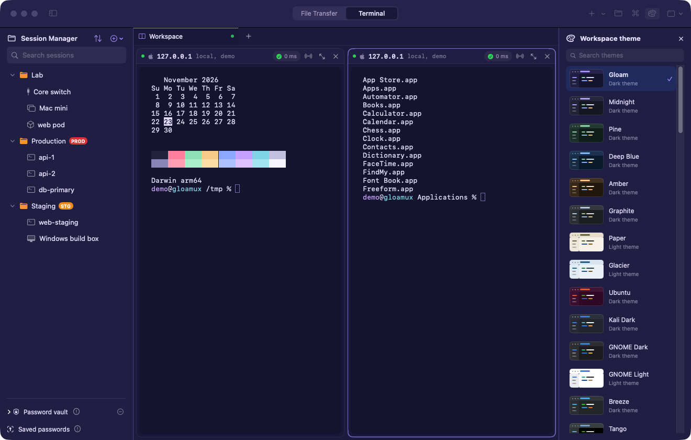
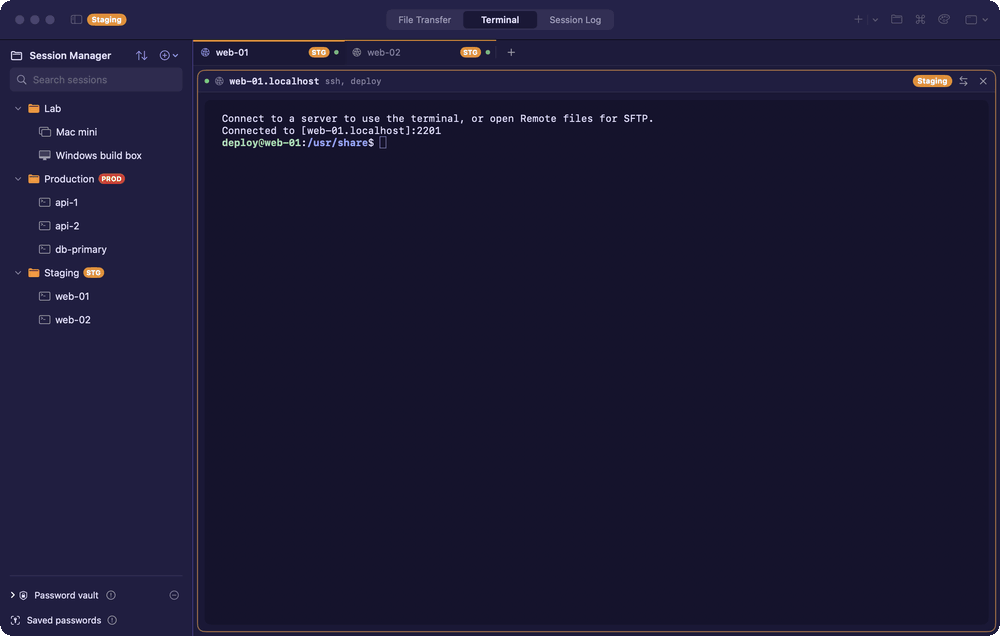
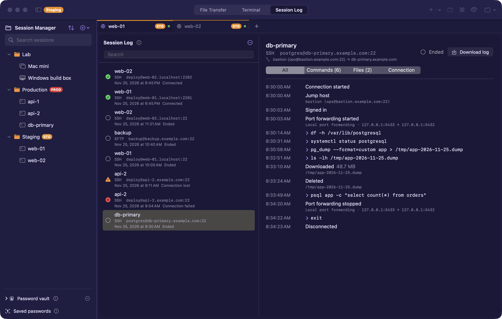
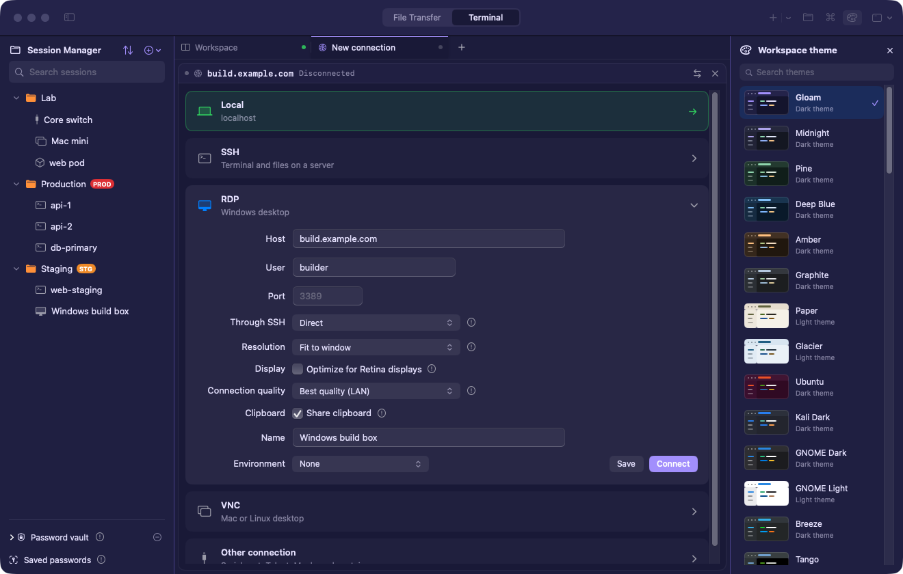

# Gloamux

[English](README.md) · [繁體中文](README.zh-TW.md)

**macOS 原生的 SSH、檔案傳輸與遠端桌面工作區。**

目前版本：**Gloamux 1.8 (build 19)**。

Gloamux 把伺服器收進同一個視窗：連線用資料夾整理，終端可以並排，伺服器的檔案就在 shell 旁邊，Windows 或 Mac 桌面也能開在分頁裡。它以 Swift、SwiftUI 和 AppKit 打造，資料全部留在你的 Mac 上，並提供 `gloamux` 命令列管理連線、控制終端、傳輸檔案和設定工作區。遠端桌面的鍵盤與指標輸入使用 App，密碼庫建立、解鎖和機密顯示也由 App 處理。

<p align="center">
  <a href="https://github.com/LuckyFishOno/Gloamux/releases/latest"></a>
  
  
  
  
</p>

<p align="center">
  
</p>

<p align="center">
  <a href="https://github.com/LuckyFishOno/Gloamux/releases/latest/download/Gloamux.dmg"><strong>下載 Gloamux</strong></a>
  ·
  <a href="https://gloamux.gloamkit.net">官方網站</a>
  ·
  <a href="docs/zh-TW/USER-GUIDE.md">使用手冊</a>
  ·
  <a href="#安裝">安裝</a>
  ·
  <a href="#第一次開啟">第一次開啟</a>
  ·
  <a href="#命令列">命令列</a>
  ·
  <a href="#從原始碼建置">從原始碼建置</a>
  ·
  <a href="https://github.com/LuckyFishOno/Gloamux/issues">回報問題</a>
</p>

## 為什麼用它？

Gloamux 給用 Mac 管伺服器、又不想同時開終端、SFTP 工具、遠端桌面 App 和一份主機清單的人。它參考 Xshell、MobaXterm 這類工具的工作方式，重新做成 Mac 原生 App。

| 你得到什麼 | 為什麼重要 |
| --- | --- |
| **所有連線放在同一個工作區** | SSH、SFTP、FTP/FTPS、RDP、VNC、序列埠、Telnet、Mosh、容器和 Pod 都在同一棵資料夾樹裡。 |
| **配合工作方式的終端** | 分頁、拖曳分割窗格、同時輸入到所有窗格，以及 73 組配色。 |
| **檔案就在 shell 旁邊** | 像 Finder 的檔案側欄會跟著目前的窗格，另有雙欄傳輸畫面。 |
| **登入一次就好** | 密碼只留在這台 Mac，由 Secure Enclave 保護，也可以另用主密碼保護的密碼庫。 |
| **正式環境的防護** | 為環境加上標籤，高風險指令在正式伺服器執行前先確認。 |
| **可寫腳本** | `gloamux` 命令列提供連線、終端和檔案操作；本機 MCP 伺服器讓 AI 代理在核可範圍內操作。 |
| **預設就重視隱私** | 不用帳號、沒有遙測。已存主機的連通性探測和更新檢查，都能各自在設定中關閉。 |

## 畫面

<p align="center">
  
</p>

把伺服器並排、切換主題，再到雙欄傳輸畫面用可續傳的佇列搬檔案。

<p align="center">
  
</p>

遇到只允許 `sftp` 加 session key 的閘道，指令只要貼一次。Gloamux 會存成連線並傳完指令裡的檔案，之後只問新的 key，而且不會儲存它。

<p align="center">
  
</p>

每次連線都會留下一筆紀錄：時間、對象、經過哪些跳板、執行過的指令、傳輸或變更的檔案，以及怎麼結束。可以搜尋、直接看，也可以下載成紀錄檔。

<p align="center">
  
</p>

新連線列出本機、SSH、RDP、VNC 和其他連線。遠端桌面可以走 SSH 通道，並選擇解析度、Retina 繪製和連線品質。

## 功能

- **終端** · 分頁、拖曳分割窗格、本機 shell、Shell 整合（提示字元標記、指令狀態、通知）、搜尋、記錄檔、會遮住密碼的終端文字錄影、視窗錄影（MP4 或 MOV），以及 73 組配色。鍵盤拷貝模式、貼上歷史、每行時間戳記、sixel、iTerm2 與 kitty 內嵌圖片、`sz` 與 `rz`（ZMODEM），以及用快速鍵叫出的下拉視窗。
- **SSH** · 密碼，Ed25519、ECDSA、RSA 金鑰，`ssh-agent`、Secure Enclave 金鑰、鍵盤互動式（PAM）登入、以 session key 取代使用者名稱的閘道、依序列出最多八層跳板並顯示每一跳的連線路徑、SOCKS 和 HTTP 代理、連接埠轉發、代理轉發、透過 XQuartz 的 X11，以及給舊伺服器和網路設備用的「相容」金鑰交換設定。
- **檔案** · 跟著目前窗格的檔案側欄、可續傳佇列的雙欄傳輸畫面、快速查看，以及用 Mac App 編輯遠端檔案，支援 SFTP、SCP、FTP 和 FTPS。貼上一次 `sftp` 指令就能存成連線。
- **遠端桌面** · 在 Gloamux 分頁裡使用 RDP（含網路層級驗證）和 VNC（含 macOS 螢幕共享），可走 SSH 通道並共用剪貼簿。
- **瀏覽器面板** · 終端旁的瀏覽器，用 Safari 的引擎（WebKit）顯示，網頁以分頁排在面板標題列，寬度可以拖曳調整，登入狀態只放在記憶體，直到 Gloamux 結束。
- **其他連線** · 序列埠、Telnet、Mosh、Docker 容器、Kubernetes Pod 和 AWS Systems Manager 工作階段。
- **連線歷史** · 每次連線都有一筆紀錄，包含執行的指令、跳板、連接埠轉送和檔案，可檢視、搜尋或下載。
- **安全** · Production、Staging、Test、Development 標籤，高風險指令確認，主機金鑰檢視與紀錄，以及鎖定工作區。
- **帶著連線過來** · 可從 Xshell、MobaXterm、PuTTY 或 KiTTY、OpenSSH 和 CSV 匯入，匯出時不含密碼。也能用 Bonjour、Tailscale 和 AWS 找主機。
- **自動化** · 快速指令、輸出觸發、Markdown 操作手冊、指令面板、Spotlight、捷徑和 `gloamux://` 連結。
- **調成你要的樣子** · 預設、經典和工作台三種版面，可調整的應用程式字級，介面提供英文、繁體中文、簡體中文、日文和西班牙文。

[使用手冊](docs/zh-TW/USER-GUIDE.md)逐步說明每項功能，並列出所有選單項目、快捷鍵、設定和指令。

## 系統需求

- macOS 14 以上
- Apple 晶片的 Mac（M1 或更新）

目前不支援 Intel Mac。

## 安裝

1. 下載最新的 [`Gloamux.dmg`](https://github.com/LuckyFishOno/Gloamux/releases/latest/download/Gloamux.dmg)。
2. 打開磁碟映像檔。
3. 把 **Gloamux.app** 拖到 **Applications**。
4. 從「應用程式」打開 **Gloamux**。

## 第一次開啟

可下載的版本是 ad hoc 簽署，沒有經過 Apple 公證，所以第一次開啟時 macOS 會要你確認。請依下方步驟核可這個版本。

如果 macOS 顯示 **無法打開「Gloamux」**：

1. 按 **完成**。
2. 打開 **系統設定**。
3. 進入 **隱私權與安全性**。
4. 捲到 **安全性**。
5. 在 Gloamux 那一列按 **強制打開**。
6. 如果 macOS 要求，就驗證身分。
7. 按 **打開**。

確認過一次之後，Gloamux 就能正常開啟。若想略過這一步，可以[從原始碼建置](#從原始碼建置)。

## 更新

Gloamux 1.1 以後的版本會自己更新。選 **Gloamux › 檢查更新**，或讓 Gloamux 每天檢查一次：第二次開啟時它會詢問，之後可在 **設定 › 一般** 的 **自動檢查更新** 改變選擇。Gloamux 會顯示更新內容，用它的簽署金鑰驗證下載的檔案，安裝後重新開啟。Gloamux 1.0 沒有更新功能，請用安裝時的方式，以新版 DMG 替換一次。

## 開始使用

- 選 **檔案 › 新連線**（⇧⌘N），再選本機、SSH、RDP、VNC 或其他連線。⌘T 開啟本機終端。
- 密碼登入成功後按 **儲存**，連線就會留在連線管理裡，之後雙擊即可開新分頁。
- 把分頁拖到窗格邊緣就能分割。⌘D 和 ⇧⌘D 分割目前的窗格。
- 工具列的 **檔案** 按鈕開啟伺服器的檔案，**檔案傳輸** 開啟雙欄畫面。
- 從工具列的 **新連線** 選單 › **匯入連線** 匯入既有的連線。

## 命令列

App 內附 `gloamux` 指令，`gloam` 是它的簡寫：

```sh
export PATH="/Applications/Gloamux.app/Contents/Resources/bin:$PATH"
```

```sh
gloamux sessions list
gloamux sessions add "Work server" ssh server.example.com deploy
gloamux sessions options "Work server" jump=Bastion x11=on
gloamux ssh "Work server"
gloamux files get --session "Work server" /var/log/app.log ./app.log
gloamux files put --session "Work server" ./build.tar.gz /srv/releases/ --overwrite
gloamux sessions from-sftp "Report gateway" 'sftp -P 4997 KEY@gateway.example.com'
gloamux sftp "Report gateway"
gloamux history list
gloamux tabs list
gloamux tabs run TAB_ID "uptime"
gloamux tabs read TAB_ID 50
gloamux forwards start TAB_ID local 8080 localhost 80
gloamux web show https://192.0.2.10
gloamux hosts discover bonjour
gloamux settings set terminal.font-size 14
gloamux config export ~/Gloamux.gloamuxconfig
```

`gloamux files` 支援 SFTP、SCP、FTP，以及明確和隱含 FTPS，並沿用已存連線的登入方式、代理、跳板和主機信任。一次性的密碼用 `--password-stdin`，只為這次指令解鎖密碼庫用 `--vault-password-stdin`，第一次連的伺服器可用 `--host-key` 帶入你核對過的指紋。這些臨時提供的憑證都不會被儲存。

`gloamux sftp` 登入一次後就能下 `sftp` 指令，可用已存連線、一般的 `sftp` 選項，或用 `--command` 讀入整段貼上的指令。`gloamux history` 可列出、匯出和移除連線歷史。

`gloamux tabs`、`gloamux web` 和 `gloamux commands send|run` 會操作正在執行的 App；`gloamux tabs list` 列出的分頁 ID 在每個視窗都能用。管理指令回傳 JSON，檔案指令可加 `--json`。結束代碼：0 成功、1 操作失敗、2 用法錯誤、130 表示被 Ctrl-C 中止。執行 `gloamux --help`，或用 `gloamux <指令> --help` 看各指令說明。

使用手冊的[命令列一覽](docs/zh-TW/USER-GUIDE.md#20-命令列一覽)列出所有指令。

Shell 補全：Zsh 先執行 `autoload -Uz compinit && compinit`，再執行 `source <(gloamux completion zsh)`；Bash 把 `gloamux completion bash` 存成檔案後 `source` 它。

### AI 代理（MCP）

`gloamux mcp` 讓 AI 代理透過 [Model Context Protocol](https://modelcontextprotocol.io) 使用 Gloamux。在 **設定 › AI 代理** 開啟它，選擇代理可以使用的連線，再把那裡顯示的指令加到代理，例如：

```sh
claude mcp add gloamux -- /Applications/Gloamux.app/Contents/Resources/bin/gloamux mcp
```

代理可以列出和開啟允許的連線、讀取你分享的輸出，並提議指令。提議的指令要你在 Gloamux 裡看過才會執行，代理也拿不到密碼或金鑰。`gloamux agents status|history|clear-history|revoke|off` 可查看及撤銷權限。

## 從原始碼建置

### 需要

- 執行 macOS 14 以上的 Apple 晶片 Mac
- 含 macOS SDK 的 Xcode
- Rust 1.94 以上（RDP 和 VNC 引擎使用）

### 建置

```sh
git clone https://github.com/LuckyFishOno/Gloamux.git
cd Gloamux
./Gloamux/scripts/package-app.sh
open build/Gloamux.app
```

只建置命令列：`swift build --package-path Gloamux --product gloamux`。

### 執行測試

```sh
swift test --package-path Gloamux
cd Gloamux/RDP && cargo test --release
```

Swift 測試約有 500 項，包含本機回送的 SSH、SFTP、FTP 和轉發伺服器。少數需要指定遠端主機或 Xshell 範例檔的測試，在沒有這些條件時會略過。

## 本機資料與隱私

Gloamux 的資料都放在你的 Mac 上：

```text
~/Library/Application Support/Gloamux
```

已存連線、主機金鑰、快速指令、操作手冊、錄影和記錄檔都在這裡。登入成功的密碼由 Secure Enclave 金鑰保護，或放進以主密碼加密的密碼庫。匯出檔和設定備份不含這台 Mac 記住的密碼。Gloamux 不用帳號，也不送出分析或遙測；它只連到你開啟的伺服器，以及可選的已存主機連線檢查，這項可以在 **設定 › 安全** 關閉，以及每天向 GitHub 檢查一次新版本，這項可以在 **設定 › 一般** 關閉。完整清單請見[資料保護](docs/zh-TW/DATA-PROTECTION.md)。

Gloamux 曾名為 Termac，更早叫 MShell。第一次啟動會從最近一個舊名稱搬移資料和設定，舊的匯出檔也能照常匯入。

## 文件

本機架構修改於 2026 年 11 月 24 日完成自動化與壓力測試，範圍和待驗證項目見[驗證紀錄](docs/zh-TW/VERIFICATION.md)。

每份文件都有英文版和繁體中文版，分別放在 [`docs/en`](docs/en) 和 [`docs/zh-TW`](docs/zh-TW)。

| 文件 | 內容 |
|---|---|
| [使用手冊](docs/zh-TW/USER-GUIDE.md) | 逐步說明每項功能，並附選單、快捷鍵、設定和指令一覽 |
| [資料保護](docs/zh-TW/DATA-PROTECTION.md) | Gloamux 儲存哪些資料、如何保護，以及規劃中的項目 |
| [開發指南](docs/zh-TW/DEVELOPMENT.md) | 原始碼結構、架構、測試和第三方授權聲明 |
| [發布流程](docs/zh-TW/RELEASING.md) | 更新文件、建置 DMG 和發布新版 |
| [路線圖](docs/zh-TW/ROADMAP.md)和[功能待辦](docs/zh-TW/FEATURE-BACKLOG.md) | 已完成和接下來的工作 |
| [配色清單](docs/zh-TW/THEME-INVENTORY.md) | 內建配色主題的來源 |

## 參與貢獻

歡迎回報問題和聚焦的 Pull Request。回報時附上 macOS 版本、Mac 機型、連線種類（SSH、SFTP、RDP、VNC 等）、知道的話也附上伺服器軟體，介面問題請附截圖或短片。請拿掉不想公開的主機名稱、使用者名稱和金鑰。

如果 Gloamux 對你有幫助，幫專案按個星星，能讓更多 Mac 使用者找到它。

Gloamux 是獨立專案，與 Apple、Microsoft、NetSarang 或 Mobatek 沒有關聯，也未獲其背書。macOS 是 Apple Inc. 的商標。Xshell、MobaXterm、Windows 和 Remote Desktop 是各自擁有者的商標。
